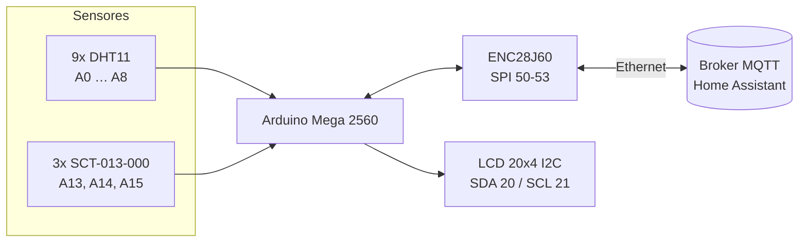

# Ligações elétricas

Guia de montagem do monitor. Pinos e parâmetros correspondem aos valores padrão de [`firmware/config.h`](../firmware/config.h).

## Visão geral



## Módulo Ethernet ENC28J60

| ENC28J60 | Arduino Mega |
| :--- | :--- |
| SO (MISO) | 50 |
| SI (MOSI) | 51 |
| SCK | 52 |
| CS | 53 |
| VCC | 3,3 V (veja a observação) |
| GND | GND |

> **Alimentação:** o ENC28J60 consome até ~180 mA. O regulador de 3,3 V do Mega fornece
> no máximo 150 mA. Use a versão do módulo com regulador de 5 V ou um regulador de 3,3 V
> externo, pois falta de corrente causa travamentos intermitentes da rede.

> A biblioteca `UIPEthernet` funciona **apenas com o ENC28J60**. Shields W5100/W5500
> precisam da biblioteca `Ethernet` oficial.

## Display LCD 20x4 I2C

| LCD (módulo I2C) | Arduino Mega |
| :--- | :--- |
| SDA | 20 |
| SCL | 21 |
| VCC | 5 V |
| GND | GND |

O endereço padrão é `0x27` (alguns módulos usam `0x3F`, ajuste `LCD_ADDRESS`).

## Sensores DHT11

| Sensor | Pino | Sensor | Pino | Sensor | Pino |
| :--- | :--- | :--- | :--- | :--- | :--- |
| 1 | A0 | 4 | A3 | 7 | A6 |
| 2 | A1 | 5 | A4 | 8 | A7 |
| 3 | A2 | 6 | A5 | 9 | A8 |

Cada sensor: `VCC → 5 V`, `GND → GND`, `DATA → pino da tabela`.

- Módulos em placa (3 pinos) já têm resistor de pull-up. Para o sensor "cru" (4 pinos),
  coloque um resistor de **10 kΩ entre DATA e VCC**.
- Em cabos longos (acima de ~5 m), use cabo par trançado ou blindado e reduza o pull-up
  para 4,7 kΩ. Sensores que falham com frequência aparecem no alerta `SENSOR_FALHA`.

## Sensores de corrente SCT-013-000

O SCT-013-000 fornece **corrente** (100 A : 50 mA). É preciso um resistor de carga (*burden*)
e um divisor que desloque o sinal para o meio da faixa do ADC (2,5 V):

```
  +5 V ──[10 kΩ]──●──[10 kΩ]── GND
                  │
                  ├──[+ 10 µF]── GND
                  │
  fio 1 do SCT ───●   ponto médio ≈ 2,5 V
                  │
               [33 Ω]  resistor de carga
                  │
  fio 2 do SCT ───●──────────► A13
```

- Repita o circuito para A14 e A15.
- Calibração: `SCT_CALIBRATION = 2000 / R_burden` (2000 / 33 ≈ 60,6). Ajuste o valor
  comparando a leitura com um alicate amperímetro.
- Abrace **apenas um condutor** (fase) do ar-condicionado. Com fase e neutro juntos a leitura é zero.
- Modelos com saída em tensão (ex.: SCT-013-030 "30A/1V") já têm o resistor interno:
  não use o resistor de 33 Ω e use `SCT_CALIBRATION` = corrente nominal (ex.: 30).
