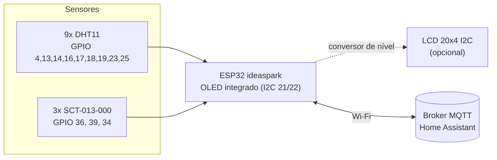

# Ligações elétricas (ESP32)

Guia de montagem do monitor com a placa **ideaspark ESP32 OLED** (ESP32-WROOM-32, 30 pinos, OLED 0,96"
integrado). Pinos e parâmetros correspondem aos valores padrão de [`firmware/config.h`](../firmware/config.h).

> ⚠️ **O ESP32 funciona com 3,3 V e seus pinos não toleram 5 V.** Nunca ligue um sinal de 5 V
> diretamente em um GPIO.

## Visão geral



## Alimentação

- Pela porta USB (5 V) ou pelo pino **VIN/5V** com uma fonte de 5 V / 1 A.
- O pino **3V3** da placa (regulador AMS1117) fornece até ~600 mA. Dá para alimentar os 9 DHT11
  (~2,5 mA cada) e o divisor dos SCT.

## Pinos a evitar

| GPIO | Motivo |
| :--- | :--- |
| 0, 2, 5, 12, 15 | Definem o modo de boot. Um pull-up no **GPIO 12** (como o do DHT) impede o ESP32 de ligar |
| 6 a 11 | Ligados à memória flash interna |
| 21, 22 | I2C do OLED integrado (podem ser compartilhados com outros dispositivos I2C) |
| 34, 35, 36, 39 | Somente entrada (sem pull-up interno); ótimos para o ADC |
| ADC2 (0, 2, 4, 12-15, 25-27) | O ADC2 **não funciona com o Wi-Fi ligado**: entradas analógicas só no ADC1 (32-39) |

Pinos livres para expansão: 26, 27, 32, 33 (entrada/saída) e 35 (somente entrada, ADC1).

## Sensores DHT11

| Sensor | GPIO | Sensor | GPIO | Sensor | GPIO |
| :--- | :--- | :--- | :--- | :--- | :--- |
| 1 | 4 | 4 | 16 | 7 | 19 |
| 2 | 13 | 5 | 17 | 8 | 23 |
| 3 | 14 | 6 | 18 | 9 | 25 |

Cada sensor: `VCC → 3V3`, `GND → GND`, `DATA → GPIO da tabela`.

- Alimente os sensores em **3,3 V**. Isso garante que o sinal DATA também fique em 3,3 V. Se precisar
  alimentá-los em 5 V (cabos longos), o resistor de pull-up do DATA tem que ir para o **3,3 V**, nunca
  para o 5 V. Módulos em placa já trazem o pull-up ligado ao próprio VCC, então nesse caso use 3,3 V.
- Sensor "cru" (4 pinos): resistor de **10 kΩ entre DATA e 3,3 V**.
- Em cabos longos (acima de ~3 m em 3,3 V), use cabo par trançado ou blindado e reduza o pull-up para
  4,7 kΩ. Sensores que falham com frequência aparecem no alerta `SENSOR_FALHA`.

## Sensores de corrente SCT-013-000

O SCT-013-000 fornece **corrente** (100 A : 50 mA). É preciso um resistor de carga (*burden*) e um
divisor que desloque o sinal para o meio da faixa do ADC. No ESP32 o divisor é ligado em **3,3 V**,
então o ponto médio fica em **1,65 V**:

```
  3V3 ──[10 kΩ]──●──[10 kΩ]── GND
                 │
                 ├──[+ 10 µF]── GND
                 │
  fio 1 do SCT ──●   ponto médio ≈ 1,65 V
                 │
              [33 Ω]  resistor de carga
                 │
  fio 2 do SCT ──●──────┬──────► GPIO 36 (VP)
                        │
                     [100 nF]  (opcional, reduz ruído)
                        │
                       GND
```

- Repita o circuito para o GPIO 39 (VN) e o GPIO 34.
- Com 33 Ω o sinal fica na faixa precisa do ADC (~0,15 a 2,45 V) até cerca de 30 A RMS, acima do consumo de um split.
- Calibração: `SCT_CALIBRATION = 2000 / R_burden` (2000 / 33 ≈ 60,6). Ajuste o valor comparando a
  leitura com um alicate amperímetro e meça o ruído com o ar desligado (`SCT_NOISE_FLOOR_A`).
- Abrace **apenas um condutor** (fase) do ar-condicionado. Com fase e neutro juntos, a leitura é zero.
- Modelos com saída em tensão (ex.: SCT-013-030 "30A/1V") já têm o resistor interno: não use o
  resistor de 33 Ω e use `SCT_CALIBRATION` = corrente nominal (ex.: 30).

## Display OLED (integrado)

Já vem ligado na placa: SSD1306 128x64, endereço `0x3C`, SDA = GPIO 21, SCL = GPIO 22. Nada a montar.

Se usar um ESP32 DevKit sem OLED integrado, ligue um módulo OLED SSD1306 I2C em `VCC → 3V3`,
`GND → GND`, `SDA → 21`, `SCL → 22`.

## LCD 20x4 I2C (opcional)

Ative com `LCD_ENABLED 1` em `config.h`. Ele fica no mesmo barramento I2C do OLED.

| LCD (módulo I2C) | Conversor de nível | ESP32 |
| :--- | :--- | :--- |
| VCC | lado HV = 5 V | VIN/5V |
| GND | GND | GND |
| SDA | HV1 ↔ LV1 | GPIO 21 |
| SCL | HV2 ↔ LV2 | GPIO 22 |

O módulo PCF8574 do LCD tem resistores de pull-up para 5 V nas linhas SDA/SCL. Use um **conversor de
nível lógico bidirecional** (ex.: módulo com BSS138, lado LV ligado ao 3V3 do ESP32). Ligá-lo direto
expõe os GPIOs a 5 V.
